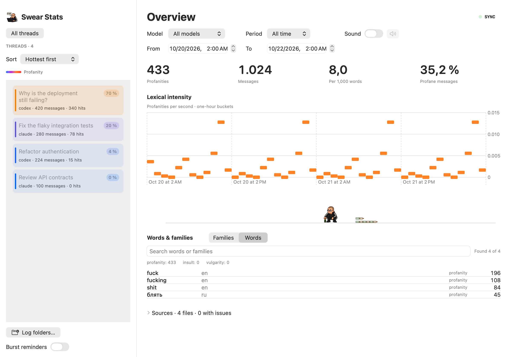

<p></p>

# Swear Stats

**See which AI conversations make you swear.** Swear Stats is a macOS app that counts profanity in your chat logs, highlights heated threads, and compares models over time. It reads Codex, Claude Code, and generic JSONL logs locally, using a bundled dictionary. Conversations stay on your Mac.

- **Find the hottest threads.** A blue-to-red sidebar accounts for both profanity frequency and conversation size.
- **Compare models and periods.** Filter the same totals, word rankings, and timeline; drag across the chart to inspect a time range.
- **Catch new outbursts.** Bro turns fresh profanity into bottles: drinks, throws empties, gets rowdy, sleeps, and sobers as you slow down. Optional “Ouch!” sounds get slower and lower as fresh profanity rises. Burst reminders add English joke notifications.
- **Keep your archive local.** Source logs stay read-only. An incremental index reads new records without rescanning the entire archive.



*Dashboard preview uses synthetic conversations.*

## Get started

Download [Swear Stats v0.0.1 for Apple Silicon](https://github.com/bobishh/ai_swear_stats/releases/tag/v0.0.1), unzip it, and move **Swear Stats.app** to Applications. Requires **macOS 13+**. This first build is locally signed and is not notarized by Apple.

To build from source, install **Swift 6.3+ with the macOS SDK**, then run:

```sh
git clone https://github.com/bobishh/ai_swear_stats.git
cd ai_swear_stats
./run-app.sh
```

1. Open **Log folders… → Add log folder…** and select your conversation-log directory.
2. Let the first import finish. New records then sync automatically; the **SYNC** light shows activity.
3. Select a thread, model, or period. Use **Words / Families** to explore vocabulary, or sort threads by **Hottest first**.

New installations detect the default Codex and Claude Code log directories. Enable **Sound** beside the filters for “Ouch!” feedback, or **Burst reminders** in the sidebar for notifications. Both are optional.

The launcher creates and locally signs `.build/Swear Stats.app`. **Command-R** refreshes manually; **Command-Q** quits. `./run-app.sh --build-only` builds without opening the app.

## Bring your own logs

| Source | Counted input |
| --- | --- |
| Codex | User messages and voice transcripts; assistant, tool, and generated delegation records are excluded. |
| Claude Code | User text; tool results, metadata, and sidechain prompts are excluded. |
| Generic JSONL | Records with `role: "user"` and string or text-block `content`. |

A generic record can be as small as:

```json
{"id":"m1","thread_id":"chat-1","model":"my-model","role":"user","content":"fix this fucking bug","timestamp":"2026-10-21T12:00:00Z"}
```

Attach a folder of `.jsonl` files. Other schemas need an adapter or conversion to this format.

## What the numbers mean

**Profanity**, **insults**, and **vulgarity** are separate categories. Only profanity contributes to thread heat, sound, and burst reminders. Heat discounts short threads; the percentage badge shows the actual share of messages containing profanity.

The dictionary covers English and Russian morphology plus reviewed word lists for German, Spanish, French, Italian, Portuguese, Dutch, and Polish. Coverage is finite. **Families** groups recognized forms using Snowball stems, language, and category; it does not infer meaning. The timeline measures language use, not psychological stress.

See the [user guide](docs/user-guide.md) for filtering, supported records, notification thresholds, indexing, limitations, and local settings. [Third-party notices](THIRD_PARTY_NOTICES.md) document the bundled dictionaries and stemmers.

## Develop and contribute

```sh
brew install swiftlint
npm install --global @fission-ai/openspec@1.4.1
./scripts/check.sh
```

Checks include Swift tests, formatting, SwiftLint, launcher syntax, and OpenSpec validation. Format Swift changes with `swift format format --in-place --recursive Sources Tests Package.swift`.

For a missed word or false positive, include the word, language, and a small synthetic example. For an unsupported log format, include a minimal sanitized JSONL record. Keep private conversations and local databases out of issues and pull requests.

Read the [Swift guidelines](docs/swift-guidelines.md) and [analytics design](openspec/changes/ai-agnostic-incremental-analytics/design.md) before changing the implementation. `CodexStatsCore` owns parsing, classification, indexing, and analytics; `CodexStatsApp` owns the native dashboard and feedback.

The [mascot specification](openspec/specs/mascot-cycle/spec.md) defines live bottle accounting, sleep, recovery, and presentation invariants.

## License

Project code is [MIT licensed](LICENSE). Bundled dictionaries and Snowball retain their own licenses; see [third-party notices](THIRD_PARTY_NOTICES.md).
