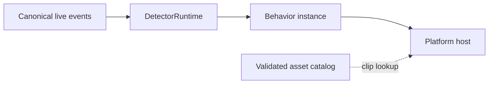

## Decisions

1. Keep the Swift engine. The current `CodexStatsCore` has no AppKit or SwiftUI dependency; portability is a build and contract proof, not a reason to rewrite the classifier and index in Rust.
2. Keep the native macOS host as the reference while proving Windows and Linux hosts. Tauri 2 is a candidate for one shared web dashboard and renderer on new platforms, subject to overlay parity tests. A common web UI is a presentation migration, not an engine rewrite.
3. Install skins as data. Behaviors remain trusted, app-owned implementations; profiles select their parameters and accepted inputs. A downloaded character cannot execute code or select a model/network destination.
4. Detectors emit typed signals. Profiles bind those signals to behavior inputs; skins only resolve the resulting scene actions. A detector never directly plays a sprite or changes mascot state.
5. Clips play at their authored cadence. Behavior controls the pauses between actions and escalation; it does not stretch every frame to make an action noticeable.

## Ownership and cognitive budget

| Context | Primary concepts | Authoritative owner |
| --- | --- | --- |
| Conversation analytics, existing | Sources, canonical events, indexed facts, selections | Existing adapters and AnalyticsIndex; index transactions and replay rules stay here |
| Signals | Detector, model provider, accepted signal, evidence window | DetectorRuntime owns admission, context lifetime, deduplication, and inference scheduling |
| Mascot behavior | Behavior definition, binding profile, behavior instance, scene | One behavior instance owns its counters, state, clocks, and action plan |
| Appearance | Package, manifest, clip, anchor | Validated asset catalog owns package identity and clip resolution |
| Platform presentation | Host, surface, capabilities | Host owns OS windows, input, screens, notifications, and audio |

No context requires more than five primary concepts. The use-case chain is `canonical event -> accepted signal -> behavior scene -> host`, three relationship hops. Admission and model work stay behind DetectorRuntime; resolving a clip is an asset lookup, not another coordinating service. These contexts remain modules in one application, not separate deployed services.



## 1. Platform independence

### Reuse and extraction

Keep JSONL adapters, lexical classification/Snowball, analytics, and actor-owned SQLite indexing in Swift. Inject resource directories, app-data directories, and source-change notifications instead of deriving them from macOS app bundles or FSEvents. Move `MascotCycle`, playback timing, and normalized scene geometry out of the AppKit target without changing the current acceptance fixtures. Engine values use portable scalars and IDs, not NSImage, NSWindow, SwiftUI bindings, or screen coordinates.

The host provides selected folders and change notifications; the engine owns file cursors, replay suppression, and reconciliation. Closing a dashboard or changing a host surface never creates another analytics index or behavior instance.

### Engine and host contract

The small engine interface accepts configuration, changed-source hints, detector settings, and binding-profile selection. It emits analytics updates, source health, accepted signal metadata, and behavior scenes. Native macOS can call this interface in-process. If a Tauri or other-language host is selected, expose the same interface through one versioned JSONL request/event stream over a supervised child process. Do not add that process to the native Mac host merely for symmetry.

A handshake declares protocol version, engine version, installed behavior contracts, and model-provider availability. Commands carry request IDs; events carry increasing sequence numbers. Reconnection requests a fresh snapshot and resumes from a known sequence; it does not replay historical mascot actions. On an engine crash, the host shows the last safe scene and reconnects, while the SQLite engine recovers its index independently.

Scenes contain an instance ID, behavior contract, revision, current action, clip phase, held pose, props, semantic anchors, and normalized interaction bounds. The engine owns scene order and action deadlines. Hosts interpolate frames with a monotonic presentation clock and the scene's authored clip timing; no 30-fps network or subprocess stream is required. Screen transforms and hit testing use the same scene projection.

### Host capabilities and fallback

A host reports desktop overlay, transparent surface, pointer passthrough, multiple displays, workspace affinity, notifications, and audio independently. Do not equate an API's existence with identical behavior across Windows, macOS, X11, and Wayland. An unavailable overlay falls back to the dashboard surface with the same behavior instance. It never quietly runs a second mascot or requests broad desktop permissions to emulate an unsupported compositor feature.

Each supported target must prove: source append/restart/partial-tail behavior; dictionary and resource loading; SQLite persistence; scene timing; transparent/topmost rendering where available; pointer passthrough; drag and screen clamping; activation/focus; hide/reopen; Reduce Motion; and packaged runtime dependencies. Windows and Linux are explicit targets, not inferred from a successful macOS build.

### Adoption sequence

- Prove the engine and existing synthetic fixtures on macOS, Windows, and Linux, including SQLite and Snowball linkage and resource discovery.
- Extract the present Bro behavior and scene projection; keep macOS behavior unchanged.
- Prototype Windows and Linux overlay hosts against that scene contract. Record capability gaps, particularly compositor restrictions.
- Choose a shared Tauri UI only after one dashboard slice and the desktop mascot meet their host contracts. Preserve the native macOS host until parity is established.

## 2. Mascot styling as downloadable packages

### Independent artifacts

A skin supplies art, clips, anchors, optional audio cues, attribution, and a behavior compatibility declaration. A binding profile supplies a trusted behavior ID plus detector-to-input bindings and behavior parameters. A detector supplies observations. These artifacts can be versioned independently.

The first package is the built-in Bro, resolved through the same catalog as an installed package. Initial distribution needs only a local `.mascotpack` ZIP or an HTTPS URL; a searchable catalog or account service is optional later.

### Illustrative manifest

```json
{
  "format": "swear-stats.mascot",
  "formatVersion": 1,
  "id": "org.swearstats.bro-classic",
  "version": "1.0.0",
  "name": "Classic Bro",
  "license": "MIT",
  "behavior": {"id": "bottle-bro", "contractVersion": 1},
  "atlas": {
    "path": "art/atlas.webp",
    "sha256": "0000000000000000000000000000000000000000000000000000000000000000",
    "cell": [192, 208],
    "columns": 8,
    "rows": 6
  },
  "clips": {
    "rest": {"frames": [0], "frameDurationMs": 120, "playback": "hold"},
    "drink": {"frames": [8, 9, 10, 11, 12, 13], "frameDurationMs": 120, "playback": "once"}
  },
  "anchors": {"ground": [0.5, 0.976], "hand": [0.8, 0.45]},
  "interactionBounds": [0.2, 0.1, 0.6, 0.88]
}
```

This is an abbreviated format example; a usable bottle-bro skin must also provide its required walk-left, walk-right, throw, rowdy, and sleep clips. The zero checksum is illustrative, not an installable artifact. Behavior contracts declare required and optional action IDs. Missing required clips reject activation; an optional action may use only the fallback declared by its behavior contract. Importing an unrelated standard pet sheet cannot silently substitute waving for drinking.

### Installation and activation

Download to staging, validate the manifest/schema version, resolve compatibility, verify declared assets, decode dimensions/frame references, and enforce bounded archive/asset sizes. Asset references are normalized relative paths inside the package; scripts, binaries, HTML, symlinks, and package-defined network requests are not accepted. HTTPS is a delivery mechanism; a checksum proves bytes match, not who published them. A later catalog can add signed publisher metadata without changing the runtime asset model.

Install immutable versions in app-owned storage. Resolve a complete compatible package before atomically switching the active catalog reference. A failed download or incompatible update leaves the current package and scene intact. Updating art does not reset behavior counters, change detectors, or alter model-provider preferences. Keep license and attribution with installed packages.

## 3. Patterns and contextual models

### Input and accepted signals

Existing MessageFact is a durable word-frequency projection, not a full chat transcript. Keep it that way. Exact profanity can use it directly. Structured failure detectors require an additional narrow live event projection from adapters: message role, canonical event ID, provider/thread/model, event time, observation time, and structured tool/build outcome where available. Do not infer tool failures from arbitrary assistant wording or start storing full tool output in the index.

Contextual detectors may request a bounded, ephemeral, role-aware window of canonical turns. The window has explicit turn/token/byte/age limits and is discarded after inference. Each detector declares permitted roles and input needs. User-profanity excludes assistant quotations and generated delegation echoes; a failure-loop detector may consume real tool outcomes without turning them into user swears.

An accepted signal carries a stable ID, namespaced kind/version, source event/window IDs, thread scope, observed/event times, detector version, confidence, evidence references, and a typed payload. Exact profanity has an integer count; a contextual signal represents a classified window, not an invented number of swear words. Unknown or insufficient evidence is a valid result and causes no mascot action.

### Bindings preserve behavior ownership

```json
{
  "formatVersion": 1,
  "behavior": "bottle-bro@1",
  "skin": "org.swearstats.bro-classic@1.0.0",
  "inputs": [{
    "signal": "language.profanity@1",
    "command": "supplyBottles",
    "quantity": "payload.count"
  }]
}
```

A binding names app-known input commands, never arbitrary functions or sprite clips. Behavior owns conservation, cooldowns, sleeps, and action interruption policy. Its scene chooses semantic action IDs; the active skin resolves them to art. Multiple mascots may subscribe to one accepted signal, but each behavior instance has its own identity and counters. Dashboard and desktop are two surfaces of the same selected instance.

### Initial detector tiers

| Pattern | Detection | Possible mascot behavior |
| --- | --- | --- |
| User profanity | Existing exact dictionary/morphology, role-filtered counts | Bro's bottle routine |
| Repeated failed tool/build attempts | Structured outcome streak/window with reset on success | A mechanic accumulates broken parts, repairs on success |
| Long back-and-forth without an accepted result | Optional bounded contextual model, with unknown/evidence output | A navigator pauses and asks for direction through a scene |
| Explicitly completed work | Structured success or explicit accepted result; no automatic inference from a cheerful reply | A character finishes a small construction |

Start with a second deterministic pattern before extracting a universal rule engine. Trusted behavior implementations plus declarative parameters are enough; a downloadable scripting VM is not required.

### Complex detector execution

A detector can use a deterministic rule, a local model adapter, or an explicitly enabled remote model adapter behind the same input/output contract. Gate model work with cheap candidates, per-thread debounce, one bounded inference queue, cancellation on superseding input, and an explicit resource budget. An optional ONNX runtime is a candidate for local models; its availability does not establish the quality of a particular language/model combination.

DetectorRuntime owns acceptance: schema and evidence checks, detector-specific confidence thresholds, bounded dedup state, live-only admission, and staleness limits. Dedup identity includes detector/version, signal kind, and canonical source event or window. Late results can be retained as diagnostics, but do not backdate or replay old animation. Reclassification or rebuilding the index remains quiet.

No model is downloaded or run merely by installing a skin. Remote chat processing stays off until a user selects a provider and enables the specific contextual detector with its data scope. Credentials belong to host/provider configuration, never to a skin. The app remains useful when a model is absent or unavailable.

### Evaluation contract

Each detector needs versioned synthetic or explicitly consented fixtures covering roles, languages, false positives, unknown results, latency, late arrival, duplicate inputs, restart, and historical replay. Model-backed labels need measured precision/recall and acceptable alert frequency before enabling a default. Report observations such as a repeated failure loop; do not present psychological diagnoses as exact telemetry.

## Official implementation references

- Swift target support: https://www.swift.org/platform-support/ and https://www.swift.org/install/windows/.
- Tauri window APIs and platform caveats: https://v2.tauri.app/reference/config/ and https://v2.tauri.app/reference/javascript/api/namespacewindow/.
- Tauri WebView differences: https://tauri.app/reference/webview-versions/.
- JSON Schema: https://json-schema.org/specification.
- Optional ONNX providers and platform-specific availability: https://onnxruntime.ai/docs/execution-providers/.
